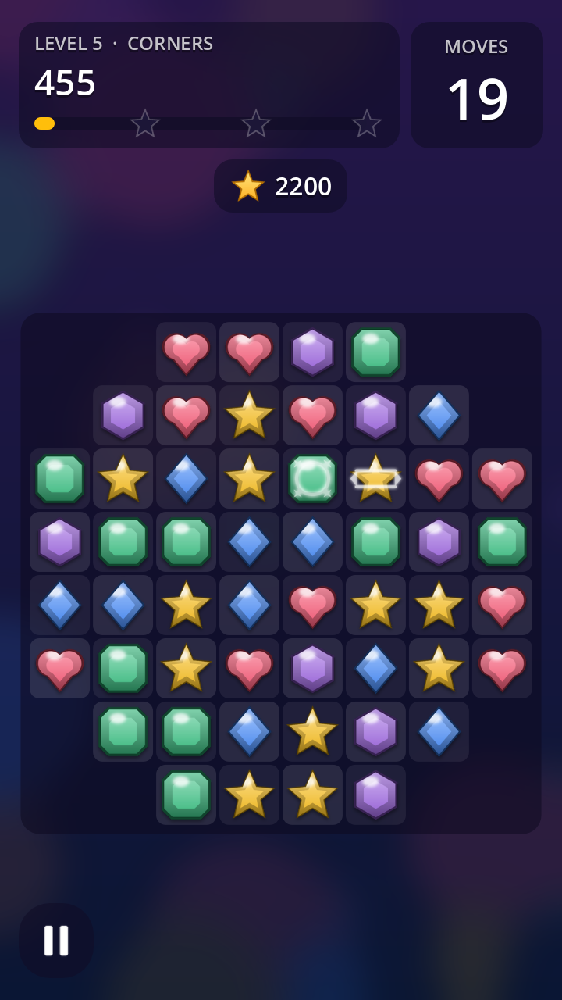

# Godot Match 3: a CodePlate template

> **Free CodePlate template, v1.3.4.** This repository mirrors the zip on [codeplate.io](https://codeplate.io/t/godot-match3/).
> Press **Use this template** to start your own repository from it, or [download the zip](https://codeplate.io/t/godot-match3/).
> [All templates](https://codeplate.io/) · [Free License](https://codeplate.io/license/free/) · subscribers get it under the [Pro License](https://codeplate.io/license/pro/) with no credit.

A complete, polished match-3 puzzle game for **Godot 4.7**, built so your AI agent can turn it into *your* game.



## What's inside

- **Board:** swap by tap or swipe; matches, cascades, falling and refilling, an automatic shuffle when no moves are left, and hints.
- **Specials:**
  - line clearers (4 in a row)
  - bombs (L/T shapes)
  - color bombs (5 in a row)
  - combos when two specials are swapped together
- **Levels:** 10 levels with score, collect and create-specials goals, holes, limited moves and 1–3 stars; progress is saved.
- **Screens:** title, settings and credits (music and effects volume, fullscreen, reset progress), level select, HUD, pause, win/lose.
- **Feel:** tweened animations, particles, beams, screen shake, score popups, rising cascade pitch, 12 sound effects and a looping music track.
- **Placeholder art and sound,** all made for this template and free to ship.
- **For your agent:**
  - a brief (`AGENTS.md`) and 13 step-by-step recipes, including ice blockers and a hammer booster
  - a headless check suite (50 checks)
  - a screenshot tool, so it can see its work
  - a level balance report

## Use it with your agent

1. Unzip this folder where you want your project to live.
2. Install [Godot 4.7](https://godotengine.org/download) if you don't have it.
3. Open the folder with your agent (Claude Code or similar) and say something like:

   > This is a match-3 game template. Read AGENTS.md, then let's turn it into my game: an ocean theme called "Reef Rush". My tile art is in ~/art/reef. Let's start with 15 levels.

The agent will ask you a few questions, record your decisions in `docs/project.md`, and change the game step by step, running the checks after each change.

## Run it yourself

```
godot --path .
```

## License

You can use, modify and ship games made from this template, including commercially. Games you share must credit "Built with CodePlate (codeplate.io)": the game's Credits page (title > Settings > Credits) already shows it, so keep that line in `CREDITS.md`. You can't resell the template itself. See [LICENSE.md](LICENSE.md). The placeholder assets are listed in `assets.json` and [CREDITS.md](CREDITS.md).

Made by [CodePlate](https://codeplate.io).
